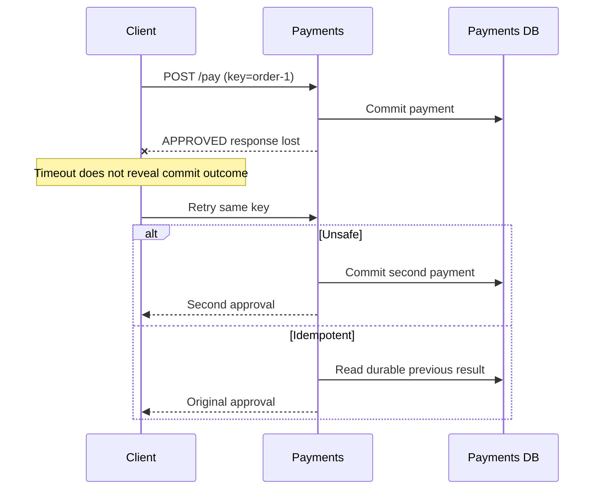

# Commerce failure and resilience lessons

These seventeen browser and headless scenarios build on the same commerce vocabulary: `order-1`,
a 5000-unit payment, service-owned databases, and explicit network/message
boundaries. Each lesson uses only the topology needed for its teaching point.
They are independent experiments, not successive mutations of one running system.

## Run and inspect

Use Node.js 22.12+ and `npm install`, then:

```sh
npm run lesson -- retry-unsafe
npm run lesson -- retry-idempotent --replay
npm run lesson -- saga-compensated --step
npm run --silent lesson -- outbox-idempotent --json > outbox.json
npm run lesson -- outbox-notifications-gap --replay
npm test -w @distlab/catalogs
```

The runner prints a filtered chronological timeline, final state, assertion
results, and an execution digest. `--json` includes the **complete** structured
history, with correlation and fault observations. `--replay` resets the session,
runs again, and verifies identical state, history, results, and digest.
`--step` accepts Enter, `run`, `state`, `reset`, or `quit`; each Enter advances one
scheduler event, not one whole business operation. All times below are virtual
milliseconds. No wall-clock sleeps or real infrastructure are involved.

Run paired names to compare equivalent workloads, fault schedules, and seeds.
Each lesson check is a **business invariant** or a **scenario expectation**
(#96). A business invariant is a property the system must keep whatever its
design, and the lessons of a family state it identically: it reads **HOLDS**
when its assertion passes and **VIOLATED** when it fails. An unsafe lesson's
finding is therefore a VIOLATED invariant, and Compare shows VIOLATED → HOLDS
for the same invariant. A scenario expectation confirms that the run reproduced
the lesson's setup and may differ within a pair.

An invariant that forbids something, such as a second charge or negative stock,
is checked after every event of the run (#163). It becomes VIOLATED at the first
moment the forbidden state exists, and it reads HOLDS only when the whole run
kept it, so its time is that first moment or the end of the run. Changing a
timeout or delaying a request cannot move a violation out of its sight. An
invariant that requires something to happen, such as "a failed order is
cancelled", is checked once, at the time by which the lesson's design must have
done it. The lesson sections give those times. The runner prints both groups
and exits non-zero only when the run fails or an expectation is not reproduced.
Assertion evidence includes the relevant database rows.

In the browser, run `npm run dev`, press **Choose a lesson**, and choose a lesson
in the Lesson chooser. Use **Step**, **Run**, and **Reset** as with checkout.
**Show service state** in the Lesson panel's ③ Investigate opens the **Service
state** dialog: committed service state, client outcomes, and live KV entries
with their expiry time for every service, side by side. Selecting a component
in the graph also shows its facts. The lesson checks are in the Lesson panel's ③ Investigate,
under a one-line outcome such as “3 of 3 business invariants violated”. When a
run ends, the panel scrolls that section into view and announces the outcome
once to assistive technology, without moving focus.
Business invariants come first, marked HOLDS or VIOLATED in words and a symbol
as well as colour. The scenario expectations follow under **Lesson setup
reproduced**. Each settled check has **Show evidence**, which opens Recorded
history at its `scenario.assertion.evaluated` record. Observation detail shows
the check's label, whether it passed at that boundary, and the rows its
predicate stored as evidence, such as both payment rows of a double charge
(#165). It reads the stored record only and never re-evaluates the check. The
record stays in the Raw view, the one view that lists every record ungrouped.
**Recorded history → Story** includes business logs such as compensation and
breaker transitions, as well as network, DB, and fault milestones. The Story
diagram and Story table views select the same underlying observations.

**Compare** loads the paired experiment with equivalent inputs and a fresh worker
session (it does not retain a side-by-side result or change rules during a run).
The host accepts only exact packaged documents, each optionally with a session
overlay that the lesson's policy allows. Compare carries the student's faults
and the shared parameter overrides
([ADR-004](spec/adr/004-session-overlays.md)). Read-only kernel counters replace
the old checkout-only history inference; see [ADR-003](spec/adr/003-boundary-counters.md).

### Design choices

**Design choices** change the settings a lesson declares as parameters before
Run ([ADR-004](spec/adr/004-session-overlays.md), #95). They are a section of
the **Experiment drawer**, which opens from the Lesson panel's ④ Experiment →
**Change the experiment…** (#143). Each control shows a one-line hint and the
lesson default. **Apply and restart**, in the drawer's footer, loads the same
packaged lesson with the choices and the student faults as one session overlay
and starts again from t=0 with the same seed. Reset replays them, and the run header lists every
choice that differs from its default, for example `idempotency=on · timeout=40`.
Setting every choice back to its default gives the packaged run exactly.

| Lessons | Choices (component or link field) |
| --- | --- |
| `retry-*` | `idempotency` (payments `idempotent`), `timeout` 1–60 (client → payments link) |
| `saga-*` | `compensation` (orders `compensate`) |
| `dual-write`, `outbox-unsafe-consumer`, `outbox-idempotent` | `outbox` (payments `outbox`), `consumer-idempotency` (notifications `idempotent`) |
| `outbox-notifications-gap` | `outbox` (payments `outbox`); the notifications slot is a design edit, not a choice |
| `cascade-*` | `circuit-breaker` (payments `breaker`) |
| `notifications-*` | `decoupled-confirmation` (orders `decoupled`), `max-attempts` 1–50 (`OrderPlaced` destination `maxAttempts`) |
| `cache-*` | `cache-invalidation` (catalog `invalidate`) |
| `inventory-*` | `optimistic-concurrency` (inventory `optimistic`) |

Checkout lessons and `cqrs-delayed` declare no choices. Each pair exposes the
switch that distinguishes it: setting it to the paired lesson's value gives the
paired architecture. The notifications pair differs in both of its choices, and
each one decides different invariants, so either one alone gives a mixed result. The checks stay the loaded lesson's. Business invariants
report what the choice achieves: switching idempotency on in `retry-unsafe` makes
"A retried payment request charges the order once" HOLD. A scenario expectation
can read "not reproduced" under a choice; that shows the changed story, not a
simulator error (#96).
Compare drops the switch the pair compares and keeps the shared ones.

### Faults

The drawer's **Faults** section adds student faults to a loaded lesson. Choose a
fault, a target (from the list, or with **Pick on graph**, which works while the
drawer is open because it is docked beside the graph rather than modal), and its
fields, which map one to one to a `FaultRule` or a scheduled fault. **Apply and
restart** loads the same packaged lesson with the faults (and any design
choices) as one session overlay and starts again from t=0. **Discard changes**
returns the draft to the applied overlay, and **Close** keeps it. Reset replays the applied faults. Student fault IDs start with
`student-`, so Recorded history shows them in `fault.rule.matched`,
`fault.effect.selected`, `fault.applied`, and `scenario.action.dispatched`.
A probability other than 1 uses the session seed. Each lesson offers only the
faults its architecture has and its models survive:

| Lessons | Fault rules | Scheduled faults |
| --- | --- | --- |
| Checkout (both) | request, response, message delivery, database commit | crash |
| `retry-*` | request, response, database commit | crash |
| `saga-*` | request, response, database commit | external availability |
| `dual-write`, `outbox-*` | request, response, message delivery, database commit | none |
| `cqrs-delayed` | request, response, message delivery, database commit | crash |
| `cascade-*` | request, response | crash, external availability |
| `notifications-*` | request, response, message delivery, database commit | crash |
| `cache-*` | request, response, database commit | crash |
| `inventory-*` | request, response, database commit | crash |

Every lesson allows up to four student faults. A scheduled crash may carry a
restart `after` some virtual milliseconds (ADR-004 amendment, #97 D-8): the
service moves to STARTING then and to RUNNING 1 ms later, so a crash can tell a
recovery story. In `retry-idempotent`, a payments service restarted before the
retry answers it from its durable result and the order is charged once; in
`retry-unsafe` it charges again. The crash and its restart count as one fault.
The Faults section does not offer the restart field yet; today the worker
accepts it in a `load` overlay, and the assessment rows (#97) will use it. Saga resources and the outbox
payment service already script their own crash and restart, so a student crash
there would end the run instead of telling a story. The checkout payments model
treats a provider error as a handler failure, so checkout does not offer
external availability, and neither does the notifications pair: its sender NACKs
only a modeled failure such as a send timeout, so a provider rejection reply
would end the run. A catalog test runs every offered kind to completion.
Packaged lesson checks still run against the changed experiment. A business
invariant may become VIOLATED and a scenario expectation "not reproduced": that
means the faults changed the story, not that the simulator failed.

## 1. Timeout, retry, and idempotency

**Pattern:** request idempotency with a durable previous result.

**Problem:** a committed payment and a lost response leave the caller uncertain.
Retrying may repeat the side effect.

**Topology:** Client → Payments → Payments DB. Both calls use `POST /pay` and the
same idempotency key, `order-1`.

**Initial state:** empty payment/result tables; service starts at t=0.

**Injected fault:** Fault Engine drops the first Payments → Client response,
not the request. Network timeout is 20 ms. Exactly one retry follows after 1 ms.



**Expected timeline:** t=1 payment commits; response is dropped; t=20 caller
records ambiguous timeout; t=21 retry begins; t=22 server processes the retry;
t=23 client receives approval. The safe handler logs `payment.previous-result`.
Payment and idempotency result are committed in the same local transaction.

**Expected final state:**

| Run | Payment rows | Returned payment ID | Charged once |
| --- | ---: | --- | --- |
| `npm run lesson -- retry-unsafe` | 2 | payment-2 | VIOLATED at t=22 |
| `npm run lesson -- retry-idempotent` | 1 | payment-1 | HOLDS |

"A retried payment request charges the order once" allows at most one payment
row at every moment of the run, which ends at t=23. With the client timeout at
40 the retry commits the second payment at t=42, and the invariant is VIOLATED
then.

**Concept:** a timeout does not imply that the remote operation failed. Replaying
the same seed reproduces the ambiguous boundary exactly. This lesson covers a
sequential retry with identical payload; concurrent keys, key expiry, and payload
mismatch rejection are intentionally outside its scope.

## 2. Saga and compensating transactions

**Pattern:** orchestrated, reverse-order business compensation.

**Problem:** independently committed operations cannot be undone by rolling back
one database transaction.

**Topology:** Client → Orders; Orders → Inventory, Payments, and external Carrier.
Orders, Inventory, and Payments each own a database.

**Initial state:** no order, reservation, or payment. Services start at t=0.

**Injected fault:** Fault Engine drops the `POST /ship` request before it reaches
Carrier. Inventory reservation and payment approval have already committed.

**Expected timeline:** create order → reserve inventory → approve payment →
shipment request lost → timeout → `NEEDS_COMPENSATION`. At t=30 assertions show
the order incomplete, inventory reserved, and payment approved. The safe variant
waits 10 virtual ms after the timeout to expose that inconsistent state, then
performs refund → release → cancel. Logs distinguish `saga.forward`,
`saga.inconsistent`, and `saga.compensation`; DB commits expose each local change.

**Expected final state at t=60:**

| Run | Order | Inventory reserved | Payment refunded |
| --- | --- | --- | --- |
| `npm run lesson -- saga-uncompensated` | NEEDS_COMPENSATION | true | false |
| `npm run lesson -- saga-compensated` | CANCELLED | false | true |

**Concept:** compensation is another business operation, not a global rollback.
The fixture deliberately has no shipment side effect and reliable compensation
links. In a real ambiguous shipment outcome, cancellation/status reconciliation
and retryable compensation would also be necessary; this is not a general saga
recovery engine.

## 3. Transactional outbox and at-least-once delivery

**Pattern:** atomic local payment/outbox persistence, asynchronous relay, and
transactional consumer inbox.

**Problem:** a service can crash after its DB commit but before publication;
publishing later can also produce duplicate consumer effects.

**Topology:** Client → Payments → Payments DB (payment + outbox); Payments relay →
MessageBus `PaymentApproved` → Notifications → Notifications DB (intent + inbox).
A notification row represents a durable notification intent, not a real email.

**Initial state:** all four tables empty; services running at t=0.

**Injected faults:** scheduled Fault Engine crash of Payments at t=5 and duplicate
message delivery with one additional copy spaced 3 ms apart. Both outbox variants
and the unsafe dual-write variant use the same fault inputs (the delivery rule
never fires if no event is published).

**Expected timeline:**

1. t=1: local payment commit. Outbox variants insert the event in that **same**
   transaction; unsafe dual write has no durable event record.
2. t=5: crash during the 10 ms commit-to-publish window. Committed rows survive;
   publication continuation is abandoned. At t=6 no notification exists.
3. t=15/16: restart through STARTING → RUNNING.
4. t=17: a maintenance client requests one relay tick. The service schedules its
   own background handler; t=19 it publishes pending outbox events asynchronously.
   The relay then marks each record sent. It does not share another service's DB.
5. t=20/23: consumer sees the same event twice. Its acknowledgement is held for
   5 ms after commit so the duplicate arrives before the bus settles the delivery.
   Safe processing commits the notification and inbox together, keyed by the
   stable business event ID, and ignores the second copy.

**Expected final state at t=50:**

| Run | Payments | Sent outbox rows | Notification effects |
| --- | ---: | ---: | ---: |
| `npm run lesson -- dual-write` | 1 | 0 | 0 |
| `npm run lesson -- outbox-unsafe-consumer` | 1 | 1 | 2 |
| `npm run lesson -- outbox-idempotent` | 1 | 1 | 1 |

**Concept:** local atomicity solves the lost-event gap, not exactly-once delivery.
A relay crash between publish and marking sent can republish a logical event;
the stable event ID is what makes consumer deduplication meaningful. The lesson
injects duplicates through the bus rather than simulating that second crash.
An additional automated commit-failure test proves payment and outbox roll back
together. The relay is a finite tick so a classroom run terminates; it is not a
production daemon or an automatic startup hook.

## 4. Eventual consistency and CQRS

**Pattern:** asynchronous read-model projection.

**Problem:** a successful write does not guarantee an immediately fresh read from
a different service.

**Topology:** Client → Orders → Orders DB; Orders → MessageBus `OrderUpdated` →
Reporting → Reporting DB. Client can read both services through VirtualNetwork.

**Initial state:** both databases contain `order-1` with status PENDING, version 0.

**Injected fault:** Fault Engine adds 40 ms to the first `OrderUpdated` delivery.

**Expected timeline:** t=1 write model commits PAID/version 1 and publishes;
t=10 assertions show PAID/PENDING; early network reads confirm the mismatch;
t=42 event reaches Reporting and the projection commits PAID/version 1; later
network reads show agreement. Logs: `cqrs.write-read`, `cqrs.projection-read`,
`cqrs.converged`.

**Expected final state:** both models PAID at t=60, with one order each.

```sh
npm run lesson -- cqrs-delayed --step
```

**Concept:** a distributed system can be correct while temporarily exposing stale
state. The consumer has one update to project; arbitrary event reordering and
projection rebuilds are not modeled in this lesson. Convergence, rather than a
synchronous read-after-write guarantee, is the invariant.

## 5. Circuit breaker and cascading failure

**Pattern:** threshold-based breaker with cooldown and one half-open probe.

**Problem:** waiting on a slow dependency consumes upstream in-flight work and
propagates failure/latency through a call chain.

**Topology:** Client → API → Orders → Payments → external Risk Provider. The
breaker belongs to Payments at its dependency boundary; it is not a network flag.

**Initial state:** no in-flight requests, zero metrics, CLOSED breaker. The same
16-request workload includes an initial burst, a larger second burst, simultaneous
recovery requests, and a final healthy request.

**Injected fault:** until t=60, Fault Engine adds 60 ms request latency on the
Payments → Risk link; Payments times out after 20 ms. Outer links have larger
budgets, so failure results propagate back through Orders and API. Late provider
replies do not retroactively make a timed-out request successful.

**Expected timeline:** first requests accumulate; two failures open the breaker;
already admitted work still times out; the second burst fails fast while OPEN;
after 30 ms cooldown the next request enters HALF_OPEN and admits one probe,
rejecting its concurrent peer; success closes the circuit. `breaker.state` logs
show CLOSED → OPEN → HALF_OPEN → CLOSED. `dependency.waiting` and
`dependency.completed` expose active requests, peak concurrency, and virtual wait.

**Expected final state at t=120:**

| Run | Risk calls | Timed-out dependency calls | Fast rejections | Peak Payments waiters |
| --- | ---: | ---: | ---: | ---: |
| `npm run lesson -- cascade-unprotected` | 16 | 13 | 0 | 10 |
| `npm run lesson -- cascade-breaker` | 5 | 3 | 11 | 3 |

"No more than 3 payment requests wait on the slow risk provider at once" is
checked after every event: the unprotected run violates it at t=36, when a
fourth request starts waiting, and the breaker keeps the peak at 3. A design
that keeps the peak lower also holds.

All upstream work drains and healthy requests succeed. Tests also compare API,
Orders, and Payments aggregate wait and peak concurrency: both are lower with
protection. Metrics are available at each service's `dependency` key in its
KeyValueStore; atomic updates avoid introducing database contention into this
experiment. Logs provide intermediate states. Aggregate wait is virtual milliseconds summed
across calls, not wall-clock time or a percentile.

**Concept:** fail-fast protection reduces dependency pressure and waiting, but
does not magically turn rejected requests into successful business operations.
The simulation models accumulating in-flight handlers, not CPU/thread-pool
exhaustion. The breaker does not cancel calls already in flight.

## 6. Notifications, bounded retry, and the dead-letter queue

**Pattern:** non-critical side effect decoupled from the order, bounded
redelivery, and a dead-letter queue (DLQ).

**Problem:** a notification provider outage must not hold an order hostage, and
retrying a failing message without a bound hides the failure and keeps load on
the provider.

**Topology:** Client → Orders; Orders publishes `OrderPlaced` to Notifications,
which sends through the external Messaging Provider and publishes
`NotificationSent` back to Orders.

**Initial state:** empty Orders and Notifications tables. The provider has sent
nothing. `OrderPlaced` delivers after 1 ms, waits 20 ms for an ACK, and retries
5 ms after a NACK.

**Injected fault:** until t=80, Fault Engine drops every Notifications →
Messaging send. Each send times out after 10 ms. Notifications does not catch the
timeout, so the delivery is NACKed and the bus schedules a retry.

**Expected timeline:**

- `notifications-unbounded`: Orders commits `PENDING` and waits for
  `NotificationSent`. `OrderPlaced` allows 50 attempts, a stand-in for "retry
  until it works". Attempts at t=2, 18, 34, 50, and 66 time out. The sixth, at
  t=82, reaches the recovered provider. Orders confirms the order at t=85.
- `notifications-dlq`: Orders commits `CONFIRMED` at checkout. `OrderPlaced`
  allows 3 attempts. The third NACK at t=44 records `message.dead`, and the
  message stays in the dead-letter queue. The provider recovers at t=80, but
  nothing re-drives the message: an operator can inspect it.

**Expected checks:**

| Run | Order at t=50 | Dead-lettered by t=60 | Attempts |
| --- | --- | --- | ---: |
| `npm run lesson -- notifications-unbounded` | `PENDING` (VIOLATED) | no (VIOLATED) | 6 (VIOLATED) |
| `npm run lesson -- notifications-dlq` | `CONFIRMED` | yes | 3 |

"No notification is attempted more than 3 times" is checked after every event,
so the unbounded run violates it at t=49, when the bus starts a fourth attempt. The unbounded
run ends at t=85 and the bounded one at t=60. The scenario expectation confirms
that no notification reached the provider before t=60. In the browser, the `OrderPlaced` state shows each delivery's state
and attempt and a **Dead-letter queue** list with the message ID, attempts used,
and reason. The `messaging` state shows the provider's availability and the
messages it accepted. Recorded history shows each `message.nacked`,
`message.retry.scheduled`, and `message.dead`.

**Concept:** the bus already bounds redelivery; the design decides the budget
and what the order waits for. A dead letter is a recorded failure that someone
can inspect, not a lost message. The two choices are independent: confirming at
checkout with an unbounded budget still retries without a bound, and a budget
of 3 with a waiting Orders dead-letters the notification and leaves the order
`PENDING` for good.

## 7. Cache invalidation and cart TTL

**Pattern:** cache-aside reads with a TTL, invalidation on write, and
ephemeral session state that expires.

**Problem:** a cached price stays live after the price of record changes, so an
order can be charged a price that was no longer valid. A cart that expired must
not be checked out.

**Topology:** the Customer client and a Backoffice client. Catalog owns the
`prices` and `price-history` tables and a KeyValueStore that caches prices.
Cart keeps carts in its own KeyValueStore. Orders reads the cart from Cart and
the price from Catalog, then commits the order.

**Initial state:** sku-1 costs 1000 (version 1, valid from t=0). Both stores
are empty.

**Injected fault:** none. An ordinary price change and the TTLs tell the story.

**Expected timeline:**

- At t=1 the customer views sku-1. Catalog misses the cache, reads 1000 from its
  database, and caches it until t=101. Cart saves cart-1 and cart-2 until t=31.
- At t=11 the back office's price change commits 1200 (version 2, valid from
  t=11) and a history row in one transaction.
- `cache-stale-price`: the cached 1000 is still live. Checkout of cart-1 reads it
  at t=24 (`price.cache-hit`), and Orders commits order-1 at 1000 at t=25. The
  stale entry expires at t=101.
- `cache-invalidated`: the price change deletes `price:sku-1` at t=11
  (`price.cache-invalidated`). Checkout misses the cache at t=24 and commits
  order-1 at 1200.
- Both carts expire at t=31 (`kv.expired`). Checkout of cart-2 at t=40 finds no
  cart, and Orders commits order-2 as `REJECTED` with reason `CART_EXPIRED`.

**Expected checks:**

| Run | order-1 price | Priced at checkout | Expired cart checked out |
| --- | ---: | --- | --- |
| `npm run lesson -- cache-stale-price` | 1000 from cache | VIOLATED | no (HOLDS) |
| `npm run lesson -- cache-invalidated` | 1200 from database | HOLDS | no (HOLDS) |

"An order is priced with the catalog price valid at checkout" compares each
placed order's price with the history row valid at its `checkedOutAt`. "An
expired cart cannot be checked out" requires each placed order to commit before
its cart's `expiresAt`. Both are checked after every event, so the stale price
is VIOLATED when order-1 commits at t=25. The scenario expectations confirm the price change at
t=15 and the rejected cart-2 checkout at t=60.

In the browser, each service's state lists its live KV entries with their key,
value, and `expires at t=…`. Step to t=2 to see both carts and the cached price;
after expiry the entries are gone from state, and Recorded history keeps each
`kv.expired` record. Orders' rows show the price used, its version, and whether
it came from the cache or the database. The headless timeline prints
`kv.expired` too.

**Concept:** a TTL bounds how long a cache can be stale; it does not make it
correct. Invalidation on write removes the stale entry at the price change. A
TTL is enough for a cart, because its expiry is the business rule. The cart
check and the commit are separate steps: delay Orders' price request in the
Experiment drawer's **Faults**, and a checkout that saw a live cart can commit after the
cart expired, which violates the cart invariant.

## 8. Concurrent stock reservation and optimistic concurrency

**Pattern:** optimistic concurrency control: read a version, and commit only if
it is unchanged.

**Problem:** two clients reserve the last unit at the same virtual time. If the
stock check and the write are separate steps, both checks can pass before
either write lands, and the unit is sold twice (check-then-act).

**Topology:** two clients, the Customer App and a Partner API client, call
Inventory's `POST /reserve`. Inventory owns the `stock` and `reservations`
tables. The partner's link has a request latency of 2 ms instead of 1 ms.

**Initial state:** sku-1 has `units: 1` (physical units on hand), `stock: 1`
(units still available), and `version: 1`. There are no reservations.

**Injected fault:** none. Two concurrent requests and a validation step tell
the story.

**Expected timeline:**

- At t=0 both clients send a reservation for sku-1.
- At t=1 (customer) and t=2 (partner) Inventory reads stock=1, version 1
  (`stock.checked`), then validates for 5 ms.
- At t=6 the customer's write commits stock=0, version 2, and the
  `res-customer-app` reservation in one transaction.
- `inventory-oversell`: each write is a fresh transaction that decrements the
  stock it finds now. At t=7 the partner's write commits stock=-1, version 3,
  and a second ACTIVE reservation. Both clients get `RESERVED`.
- `inventory-optimistic`: the check and the write share one transaction. The
  partner's transaction read version 1, and the customer's commit moved the
  database past it, so at t=7 the commit is rejected with
  `TRANSACTION_CONFLICT` (`database.transaction.rejected`,
  `reservation.conflict`). Inventory re-reads stock=0 and answers
  `OUT_OF_STOCK` (`reservation.out-of-stock`).

**Expected checks:**

| Run | Final stock | Partner outcome | Stock never negative | One reservation per unit |
| --- | ---: | --- | --- | --- |
| `npm run lesson -- inventory-oversell` | -1 | `RESERVED` | VIOLATED | VIOLATED |
| `npm run lesson -- inventory-optimistic` | 0 | `OUT_OF_STOCK` | HOLDS | HOLDS |

"Stock is never negative" checks every stock row. "A unit has at most one
active reservation" compares each SKU's ACTIVE reservations with its `units`.
Both are checked after every event: the oversell is VIOLATED at t=7, when the
partner's write commits, and the run ends at t=8.
The scenario expectation confirms that the last unit was still available at
t=3, while both reservations were being validated.

In the browser, Inventory's state shows the stock row with its version and the
reservations, and each client shows its outcome. In Recorded history, each
`database.write.staged` and `database.transaction.committed` record carries the
row's before and after values. In the optimistic run, the partner's staged
write (stock 1 → 0) is followed by `database.transaction.rejected` at t=7 and
never reaches committed state. The headless timeline prints the rejection too.

**Concept:** the database detects a stale snapshot only when the read and the
write are in the same transaction. Its version check is coarse: any write
commit since the transaction began causes a conflict
([ADR-002](spec/adr/002-runtime-model-semantics.md)). Optimistic concurrency
does not block the second client. It makes the loser find out at commit time,
and the loser must re-read and decide again; here it retries once.

## 9. Design the missing consumer ("fill the gap")

**Pattern:** a constrained design exercise
([ADR-005](spec/adr/005-architecture-editor.md)). The student composes catalog
models; they never write handler code.

**Problem:** the outbox reliably publishes `PaymentApproved`, but no service is
there to turn it into a notification.

**Topology:** the outbox story of section 3 with the idempotent variant's
inputs: Client → Payments → Payments DB (payment + outbox), relay → MessageBus
`PaymentApproved`. `notifications` is a **slot** filled by the placeholder model
`commerce.placeholder-service`. It has no database and no subscription. A
placeholder exposes only the endpoints listed in its configuration field
`interface` (here none), answers each with an error reply whose body is
`{ code: "NOT_IMPLEMENTED" }`, and consumes, publishes, and stores nothing.

**Injected faults:** the same Payments crash at t=5 and duplicate delivery of
`PaymentApproved` as section 3. The duplicate rule names the slot's ID, so it
applies to whatever model fills it.

**Architecture allowance:** fill the `notifications` slot with
`commerce.notifications@1.0.0` (option `idempotent`), attach a database to
`notifications`, and subscribe `notifications` to `PaymentApproved`. At most
three design edits. No binding is offered, and no design choice targets the slot.

**Expected checks:**

| Design | Notification effects | One notification per payment | Event published |
| --- | ---: | --- | --- |
| Packaged (empty slot): `npm run lesson -- outbox-notifications-gap` | 0 | VIOLATED | HOLDS |
| Slot filled, database attached, subscribed | 2 | VIOLATED | HOLDS |
| The same with `idempotent` on (reference design) | 1 | HOLDS | HOLDS |

Every scenario expectation of section 3 is reproduced by the packaged run, so
the empty slot is a meaningful first run: the event is published and never
delivered. A design that fills the slot without a database is rejected with
`STORAGE` at `/architecture/slots/0/model`. A design without the subscription is
rejected with `SUBSCRIPTION` at `/architecture`, because no edit names the
missing subscription. Each design has its own `runId`, and Reset replays it.
The browser's Design editor (#112) will offer these edits; until then the
worker accepts them in a `load` overlay, and catalog tests run the fixture
designs above.

Until the Design editor exists, the browser says so (#164). The Lesson chooser
card and ① Goal of every lesson whose overlay policy allows architecture edits
add: "The design step is not available in the browser yet. You can run the
lesson with the empty slot and see what is missing." The `notifications` node
carries an **Empty slot** badge and a dashed outline, its accessible name ends
in "empty slot", and the Component inspector explains that no model fills it.
A component is an empty slot when its declared model is a placeholder
(`placeholder: true` in its data-only descriptor). Setting
`DESIGN_EDITOR_AVAILABLE` in `apps/web/src/design-step.ts` removes the notice;
the empty-slot marks stay, because they describe the architecture.

## Extension points and boundaries

The implementation uses versioned `ScenarioModel` factories in
`packages/catalogs/src/commerce/`, data-only documents in `commerce/scenarios.ts`,
and the existing `DeterministicScenarioEngine`/`openHarness`. The existing checkout
catalog is unchanged. Models use controlled generator tasks, VirtualClock,
VirtualNetwork, Database, MessageBus, Fault Engine, and `runtime.log`.
KeyValueStore holds atomic circuit metrics, cached prices, and carts; durable
payment and consumer deduplication use local DB transactions.

The headless lessons required no new simulation semantics. Browser integration
adds read-only Simulation counters because the initial host inferred counts from
checkout history; scheduling and golden digests remain unchanged. The
existing service clock schedules relay background work; a finite maintenance
request bootstraps it after restart. No simulation state depends on host timers,
randomness, fetch, or external infrastructure.

All documents carry explicit state/count or metric assertions. Tests validate each document,
exercise the behavioral invariants, and compare complete fresh, reset, and stepped
exports. Scenario pairs share their seed, workload, faults, and business
invariant assertions; only the relevant policy configuration and scenario
expectations differ.
