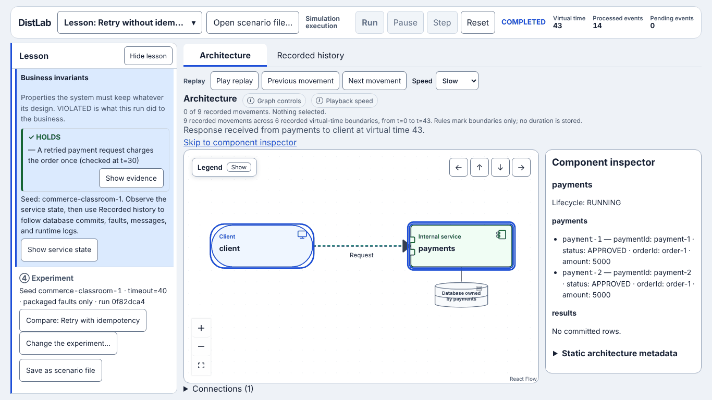
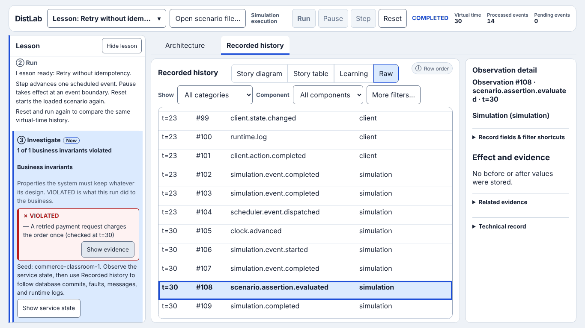
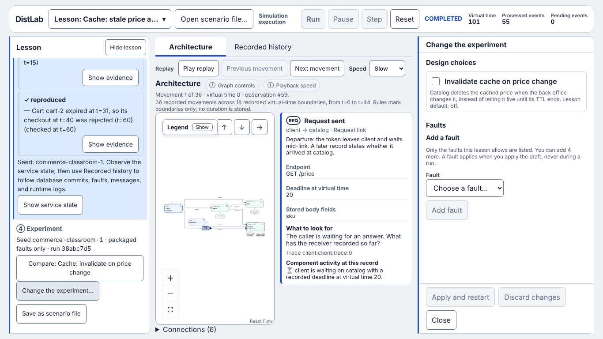
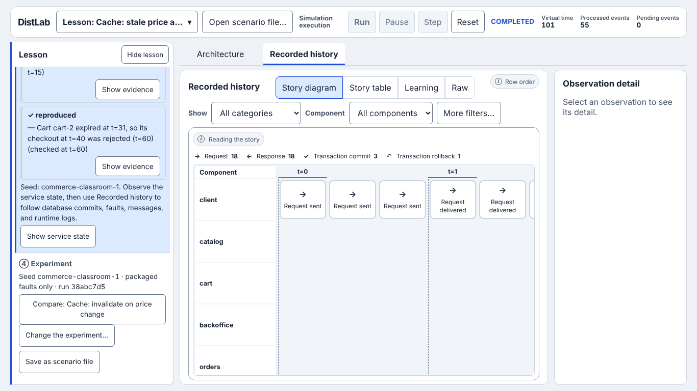

# Student evaluation: ITBA 73.40 Arquitectura de Microservicios

November 2026. Build evaluated: `main` at `68a0130`, production build
(`npm run build`, served with `vite preview`).

This document answers one question: **does DistLab help a student of this
course, or is it too complicated or too basic?** It records what was tried, what
worked, and what did not. The proposals that follow from it are in
[RFC 0001](../../rfc/0001-course-ready-design-module.md).

## Who evaluated, and how

The evaluator is an AI agent playing a student of 73.40 (Ingeniería en
Informática, ITBA), working from the 2025 course programme. It is a heuristic
evaluation by one evaluator. It is **not** a study with real students, and it
measures no learning. Treat the judgments as hypotheses to check in a pilot
(see [What this evaluation cannot tell you](#what-this-evaluation-cannot-tell-you)).

What was exercised, in Chromium through Playwright at 1440×900 and 1366×768,
with smoke checks at 1280×720 and 390×844:

- All 19 packaged lessons (2 checkout, 17 commerce), each loaded and run to
  completion. No console error or warning in any of them; the slowest run took
  1.2 s of wall time.
- One lesson stepped event by event from start to end; replay controls and the
  three speeds; the four Recorded history views; Show evidence; Service state;
  the Component inspector.
- The Experiment drawer: every design choice, input validation, each fault form,
  Pick on graph, a probability fault, Apply and restart, Compare.
- Save as scenario file, then import of a valid file, a file with an unknown
  model, broken JSON, and a YAML file.
- The headless runner (`npm run lesson -- retry-unsafe`).

## Verdict

**DistLab brings real value for one part of this course, and it is not ready to
hand to a class yet.**

- It is useful for the *design* module: patterns, synchronous and asynchronous
  interaction, and what each service knows after a failure. That module carries
  the midterm, which is 45% of the grade. Nothing else I have access to as a
  student lets me lose a response on purpose and look at both sides afterwards.
- It is irrelevant, by design, for about three fifths of the course: containers,
  Docker, Kubernetes, CI/CD, and AWS Lambda. That is correct. It should stay a
  complement and say so.
- The concepts are at the right level. The **interface is more complicated than
  the ideas it teaches**, and **what I am allowed to do is too basic**: in most
  lessons I can flip one switch.
- One defect makes the tool teach something false
  ([F1](#f1-a-business-invariant-reads-holds-while-the-final-state-violates-it)).
  It must be fixed before any student sees it.

## What the course asks for

The programme has five modules, 51 hours (40 theory, 11 practice), ten weekly
practice guides, a midterm after the design module, and a group project.

| Course module | What DistLab offers today | Fit |
| --- | --- | --- |
| Containers: Linux, cgroups, Docker, Compose, secrets | Nothing (vision §23 non-goal) | None, correctly |
| **Design of a microservices architecture**: DDD, event storming, sync/async interfaces, choreography and orchestration, design patterns | Retry and idempotency, Saga (orchestrated), outbox and inbox, CQRS lag, circuit breaker, DLQ, cache, optimistic concurrency | **Strong, with gaps** |
| Kubernetes, Helm | Nothing | None, correctly |
| Complements: CI/CD, IaC, testing distributed systems, API gateway, service mesh, observability and traces | Traces and causation in Recorded history; fault injection as a testing idea; the resilience behavior a mesh provides | Partial, conceptual |
| Serverless: a Lambda choreography | At-least-once delivery, idempotent consumer, DLQ | Conceptual only |

Two of the five learning objectives are DistLab's territory:

- Objective 3: understand and apply design patterns, and **select the most
  adequate ones for the problem**.
- Objective 4: understand synchronous and asynchronous interfaces, and
  **evaluate and choose** between them by advantages, disadvantages, and use case.

The practice guides are described as "a base situation on which the student
must make modifications or draw conclusions". That is exactly the shape of a
DistLab lesson plus the Experiment drawer. This is the strongest argument for
the project: it fits an existing course activity without changing the course.

### Design-module topics against the lesson catalog

| Topic in the programme | Lessons | Gap |
| --- | --- | --- |
| Timeout, retry, idempotency | `retry-*`, both checkout lessons | None |
| Orchestration | `saga-*` | Compensation cannot fail and be retried |
| **Choreography** | None | The course has a practical case study on choreography and a Lambda choreography in the project. No lesson shows an event-driven saga, or compares it with the orchestrated one. |
| **Sync or async for the same workflow** | `notifications-*` touches it through `decoupled-confirmation` | No lesson runs one workflow both ways and shows the trade: latency and coupling against eventual consistency |
| **Monolith compared with microservices** (minimum contents) | None | There is no baseline where one local transaction does the job, so I never see what was lost by splitting |
| Refactoring a monolith (minimum contents) | None | No strangler or anti-corruption step |
| Outbox, inbox, at-least-once | `dual-write`, `outbox-*` | None |
| CQRS, eventual consistency | `cqrs-delayed` | One lesson, no pair, no design choice |
| Circuit breaker, cascading failure | `cascade-*` | On or off only: no threshold, cooldown, or timeout to tune |
| DLQ, bounded retry | `notifications-*` | None |
| Cache, TTL | `cache-*` | None |
| Concurrency | `inventory-*` | None |
| API gateway, composition, BFF | The `api` node in `cascade-*` | Not taught as a pattern |
| Service discovery, load balancing, replicas | None | No component can have more than one instance |

## What worked

These are the moments where I learned something I would not have learned from a
slide.

1. **Seeing both sides of a lost response.** In *Retry without idempotency*,
   Service state shows two `APPROVED` payments for `order-1` beside a client
   that believes it paid once. The statement "a timeout does not prove failure"
   stopped being a sentence and became two rows.
2. **My own experiment found a case no lesson describes.** I added one fault to
   the same lesson: drop the first request. The packaged fault then dropped the
   response to the retry. Result: one payment `APPROVED`, the client's outcome
   `UNKNOWN`, the invariant green. I concluded that idempotency protects the
   server and does nothing for a caller that never gets an answer. Nobody told
   me that; the simulator let me find it.
3. **Breaking the fix.** In *Saga: compensate* I dropped the refund request. The
   order stayed `NEEDS_COMPENSATION` with the payment still `APPROVED` and the
   inventory reserved. Compensations are requests too, and they can fail. This
   is the next thing a real design has to answer.
4. **"What to look for" prompts** in the movement detail ("The response was
   discarded. What will the caller do next, and what will the sender still
   believe?"). They are the best teaching text in the product.
5. **Business invariants separated from scenario expectations**, with
   VIOLATED → HOLDS across a pair. It tells me what the business lost, not
   which test failed.
6. **No setup.** I never met a container, a language, a broker product, or a
   credential. The abstraction goal is met.
7. **Determinism.** The same lesson, faults, and seed always gave the same run,
   so I could reason about a change instead of about noise.
8. **Scenario import fails well.** A bad file gets a path and a reason for each
   problem (`/scenario/architecture/components/1/model UNKNOWN_MODEL`).

## Too complicated, or too basic?

Both, in different places.

**The interface is more complicated than the concepts.**

- There are two timelines. Run finishes the whole simulation at once and nothing
  moves. Then a separate group, Replay, moves a cursor over what already
  happened. I had to learn that distinction before I could learn anything about
  retries.
- Step advances one scheduler event, which is not a unit I think in. In the
  retry lesson the first three steps change nothing visible, and the run takes
  14 steps for 9 movements.
- A lesson with two components records 110 observations; 13 of them are
  milestones. The Raw and Learning views list `scheduler.event.dispatched` and
  `clock.advanced` beside the request I care about.
- Student-visible copy is written to be exact about the simulator rather than
  helpful to me: "Rules mark boundaries only; no duration is stored", "replaces
  the worker session", "this projection does not provide authorized start/end
  boundaries".

**What I can do is too basic.**

- Most lessons offer one checkbox, and the checkbox is the answer: Idempotency
  key, Compensation, Circuit breaker. `cqrs-delayed` offers none.
- The pattern's name is in the lesson title and the result is in its
  description ("Expect two payments after retry"), so I never have to diagnose
  anything or choose between patterns. Objective 3 asks for exactly that choice.
- A pattern is a switch with no visible mechanism. With idempotency on, a row
  appears in `results`, and I must infer the algorithm from database commits.
  A short description of what the handler does, in steps, would not be an
  implementation detail; it is the pattern.
- Patterns have no visible cost. The course asks me to weigh advantages and
  disadvantages, and only the circuit-breaker lesson shows a price (rejected
  calls). No lesson shows added latency, extra storage, or lost availability.
- I cannot design. The one design lesson cannot be completed in the browser
  ([F2](#f2-the-design-lesson-cannot-be-completed-in-the-browser)).
- The seed is fixed, so a fault with probability 0.5 has one outcome forever.

## Does it abstract implementation details?

Yes. That part of the vision is delivered, and it is the reason the tool is
worth continuing. Three consequences need attention:

- **Handlers are black boxes**, as described above.
- **There is no bridge back.** The project for this course is built with Kafka,
  n8n, Kubernetes, and Lambda. After a lesson I do not know that
  "maximum attempts, then dead-letter queue" is a redrive policy, or that a
  service mesh gives me the timeout and the breaker. One line per lesson would
  do it without modeling any product.
- **Every edge says "Request".** The operation name (`POST /pay`, refund,
  reserve) only appears after a run, in the movement detail.

## Findings

Severity: **Blocker** means fix before any release to students. Evidence is
reproducible on the build named above. F1 to F4 have issues; F5 to F11 are
matters of direction and are taken up in RFC 0001.

### F1. A business invariant reads HOLDS while the final state violates it

Blocker. Teaching correctness. Tracked in #163.

Steps: load *Retry without idempotency*; in the Experiment drawer set Client
timeout to 40; Apply and restart; Run.

Result: the run ends at t=43 with `payment-1` and `payment-2` both `APPROVED`
for `order-1`. The Lesson panel says "All 1 business invariants hold" and
"✓ HOLDS — A retried payment request charges the order once (checked at t=30)".

A student concludes that a longer timeout prevents the double charge. It delays
it past the moment the check looked.

The same false HOLDS appears with one student fault instead of a design choice:
*Delay request*, client → payments, occurrence 2, 30 ms.

Cause: every assertion in `packages/catalogs/src/commerce/scenarios.ts` uses
`mode: "at"` with a time chosen for the packaged story. Design choices and
student faults (ADR-004) can move the story past that time. ADR-004 notes that
packaged assertions can *fail* under an overlay; it does not mention that they
can *pass* falsely. `timeout=40` is the example value in
`docs/commerce-lessons.md`.

I confirmed the defect in the retry family. Every other family has the same
structure, so it should be checked for each one.

### F2. The design lesson cannot be completed in the browser

Blocker. Dead end. Tracked in #164.

*Outbox: design the notifications consumer* is offered in the Lesson chooser.
Its goal says "Fill the slot, give it a database, and subscribe it." The
Experiment drawer offers one switch (Transactional outbox) and faults. There is
no way to fill a slot; the Design editor is #112. The `notifications` node looks
like any other service, and its inspector says "Lifecycle: STARTING".

Until #112 lands, the chooser should not offer the lesson, or should mark it as
not yet available in the browser.

### F3. Show evidence does not show the evidence

High. Tracked in #165.

Show evidence on a VIOLATED invariant opens Recorded history in the Raw view at
`scenario.assertion.evaluated`, among scheduler records. The detail panel says
"No before or after values were stored." The two payment rows that prove the
violation are inside the collapsed *Technical record*, as JSON.

### F4. The graph becomes unreadable at the supported baseline

High. Tracked in #166. Measured at 1366×768.

| State | Canvas width | Zoom | Node label size |
| --- | --- | --- | --- |
| `cache-stale-price` on load, legend open | 992 px | 0.48 | 7.6 px |
| Movement detail open | 680 px | 0.47 | 7.5 px |
| Movement detail and Experiment drawer open | 268 px | 0.19 | 3 px |

The legend is open on first load and covers 21% of the canvas. The layout
budget test protects the canvas height, not what is legible inside it.

Epic #136 left the graph area for its own examination; #166 is input for it.

### F5. Two timelines, and a Step that shows nothing

High. Described under [Too complicated](#too-complicated-or-too-basic). While
stepping, the readout says "0 of 2 recorded movements. Nothing selected." and no
token is drawn: the simulation's position and the replay cursor are unrelated,
so stepping does not animate the thing that just happened.

### F6. Replay does not scale to a busy lesson

Medium. Measured speeds: Slow 0.6, Steady 1.1, Fast 2.8 movements per second.
`cascade-unprotected` has 269 movements: 7.5 minutes at Slow, 1.6 at Fast. There
is no scrubber and no jump to a time or a fault. Replay also shows one movement
at a time, so sixteen concurrent requests piling up on Payments, which is the
point of the lesson, is never visible as a pile.

### F7. The Story diagram is not the diagram a student expects

Medium. It is lanes of cards with no arrow between lanes, so it does not read as
a sequence diagram. A card sits in the lane of the component that recorded it:
"Response received" is drawn in the `payments` lane, although the client
received it. A "Request sent" card does not say where the request goes. For
`cache-stale-price` the strip is 4084 px wide in a 668 px viewport, so about a
sixth of the story is on screen.

### F8. Lesson copy contradicts the applied experiment

Medium. With Idempotency key on, the panel still says "Retry without
idempotency … Expect two payments after retry." The ② Run section keeps
"Lesson ready" after the run completed.

### F9. The chooser gives the answer away

Medium. Titles name the pattern and descriptions state the result, against
vision §18 ("The problem should appear before the solution pattern"). The
groups have no heading, and nothing suggests an order or a level.

### F10. Compare does not compare

Medium. It replaces the session with the paired lesson. The run I wanted to
compare with is gone, so the comparison happens in my memory.

### F11. Invariants only see what the author anticipated

Medium. In the experiment of [What worked](#what-worked) item 2, the client ends
`UNKNOWN` and the panel is all green. Some "business invariants" are also design
prescriptions rather than business properties: "No notification is attempted
more than 3 times", "waiting … peak at 3" (#124 covers the second).

### F12. Other observations

Low, or already tracked.

- The two checkout lessons come first in the chooser and use an older,
  text-heavy panel (#103).
- Raw identifiers in Service state: 64-character message IDs,
  `AVAILABLE · {}` (#103).
- Permanent explanatory prose (#147).
- No URL parameter and no stored state: a practice guide cannot link to a
  lesson, and a reload loses the session.
- English only. The course is taught in Spanish; its bibliography is in English.
- Design-choice inputs validate well ("Enter a whole number from 1 to 60").

## What this evaluation cannot tell you

- Whether students learn more with DistLab than without it.
- How long a real student takes to reach the first "aha", or where they give up.
- Anything about screen readers, Firefox, or Safari.

A pilot answers these cheaply: three to five students of the course, one guide
with two lessons, and three written questions before and after. RFC 0001
proposes it as the gate before release.
